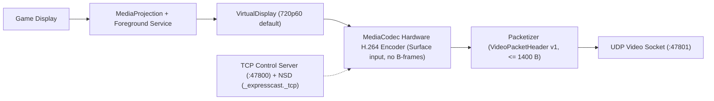
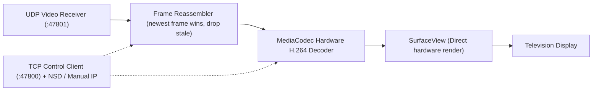

# ExpressCast Architecture

## 1. Module Layout

```text
ExpressCast/
├── phone/       # com.expresscast.phone (minSdk 29) — capture, encode, serve
├── tv/          # com.expresscast.tv    (minSdk 26) — discover, receive, decode, display
├── shared/      # com.expresscast.shared (Kotlin/JVM) — protocol, config, packet framing
├── docs/
│   └── architecture.md
├── AGENTS.md
├── settings.gradle.kts
├── build.gradle.kts
└── gradlew
```

- `shared` is a pure Kotlin/JVM library (`org.jetbrains.kotlin.jvm`, JVM target 11) so protocol logic stays platform-independent and fast to unit test on the host JVM.
- `phone` targets `minSdk = 29` (Android 10+), giving clean support for `MediaCodecInfo.isHardwareAccelerated`, `WifiManager.WIFI_MODE_FULL_LOW_LATENCY`, and modern `MediaProjection` foreground service behavior.
- `tv` targets `minSdk = 26` (Android 8.0+) so older Android TV 8/9 set-top boxes and televisions remain supported.

## 2. Streaming Pipeline

### Phone (Sender / Server)



### TV (Receiver / Client)



## 3. Transport Decision Record

**Decision:** Custom **UDP video channel** (`DEFAULT_VIDEO_PORT = 47801`) paired with a **TCP control channel** (`DEFAULT_CONTROL_PORT = 47800`), rather than WebRTC or TCP video.

- **Why not WebRTC:** WebRTC bundles a large native dependency (`libwebrtc`), mandatory ICE/DTLS/SRTP negotiation, adaptive jitter buffers, and pacing/congestion heuristics tailored for WAN/conferencing. On a 1–3 ms local Wi-Fi LAN, WebRTC's built-in buffering adds avoidable latency and obscures direct control over `MediaCodec` buffer submission and frame dropping.
- **Why not TCP for video:** TCP head-of-line blocking stalls newer frames whenever a single packet is delayed or lost, causing multi-frame latency spikes unacceptable for gaming.
- **Why UDP + TCP control:**
  - **UDP video** carries fragmented H.264 access units prefixed with `VideoPacketHeader` (22-byte big-endian custom v1 header, MTU-safe `MAX_DATAGRAM_SIZE = 1400`).
  - **TCP control** handles low-volume, reliable state: protocol version handshake (`ProtocolInfo`), pairing confirmation, stream configuration negotiation, heartbeats, telemetry/stats, and on-demand keyframe requests (`IDR` recovery).
  - Because networking is decoupled from encoding/decoding behind transport interfaces, swapping the custom v1 framing for standard **RFC 6184 RTP** remains straightforward in Phase 4+ without rewriting the codec or UI layers.

## 4. Discovery, Manual IP, and Pairing Plan

- **Discovery:** The phone advertises `_expresscast._tcp` via Android NSD/mDNS (`NetworkConfig.NSD_SERVICE_TYPE`). The TV browses for available ExpressCast servers on the local subnet.
- **Manual IP fallback:** Enterprise, mesh, or router AP/client-isolation configurations frequently drop multicast mDNS traffic. Both apps will provide direct IP entry connecting to the phone's control port.
- **Pairing:** To prevent unauthorized LAN connections or unintended screen capture exposure, connecting over the TCP control channel will require confirming a short one-time pairing PIN shown on the TV/phone before video streaming begins (implemented in Phase 2/7).

## 5. Low-Latency Principles

- **No large jitter buffer by default:** Frames are handed to the decoder as soon as reconstructed rather than queued to smooth variance.
- **Newest frame wins:** If newer complete frames arrive while older incomplete or queued frames are waiting, stale frames are discarded.
- **On-demand keyframe recovery:** Rather than using very short GOP intervals (which waste bitrate), `keyframeIntervalSec` defaults to `2` seconds and the TV immediately sends a keyframe request over TCP whenever packet loss corrupts an active frame or upon reconnection.
- **Fast decoder recovery:** On connection interruption or stream restart, the TV flushes/resets the `MediaCodec` decoder and waits for fresh SPS/PPS + IDR (`FLAG_CODEC_CONFIG` / `FLAG_KEYFRAME`) before rendering again.

## 6. Codec Capability & Fallback Strategy

Devices differ widely in hardware encoder/decoder support. ExpressCast will never hardcode a single codec name or assume 1080p60 support:

1. Query `MediaCodecList(MediaCodecList.REGULAR_CODECS)` for `video/avc` (H.264).
2. Prefer hardware-accelerated codecs (`MediaCodecInfo.isHardwareAccelerated` on API 29+ on phone, and checking software-codec prefixes on API 26–28 TV devices).
3. Verify `VideoCapabilities.areSizeAndRateSupported(width, height, fps.toDouble())` before configuring.
4. Configure low-latency encoding/decoding hints safely:
   - `KEY_MAX_B_FRAMES = 0` (no B-frame reordering delay).
   - `KEY_PRIORITY = 0` (realtime priority).
   - `KEY_LOW_LATENCY = 1` on **API 30+** (guarded by SDK check; older API 26–29 devices omit it or use safe vendor fallbacks if needed).
   - `KEY_BITRATE_MODE = BITRATE_MODE_CBR` or `VBR` depending on encoder capability query.
5. **Fallback ladder:** Start at `720p60 @ 12 Mbps` (`VideoStreamConfig.DEFAULT`). If the queried encoder/decoder cannot sustain `1080p60` or `720p60`, step down resolution (`1080p -> 720p`) and then frame rate (`60 -> 30 fps`).

## 7. Compatibility Risks & Mitigations

| Area | Risk | Mitigation |
|---|---|---|
| **minSdk split** | TV boxes often run Android 8/9 while phone APIs like `WIFI_MODE_FULL_LOW_LATENCY` and `isHardwareAccelerated` arrived in API 29. | `phone` uses `minSdk = 29`; `tv` uses `minSdk = 26` with SDK-guarded codec checks. |
| **MediaProjection (Android 14+)** | Requires `FOREGROUND_SERVICE_MEDIA_PROJECTION` permission, starting the foreground service *after* user consent, single-use consent tokens, and Android 14+ single-app capture behavior. | Implement strict consent -> FGS start lifecycle in Phase 3; re-prompt when token expires. |
| **Protected content (`FLAG_SECURE`)** | Games or DRM apps marked `FLAG_SECURE` render black frames over `MediaProjection`. | Expected OS security boundary; surface clear status rather than failing silently. |
| **Low-latency codec key** | `MediaFormat.KEY_LOW_LATENCY` is API 30+. | Guard with `Build.VERSION.SDK_INT >= Build.VERSION_CODES.R`; avoid crashing on API 26–29. |
| **Encoder limits** | Mid-range phones may reject 1080p60 H.264 encoding. | Default to 720p60 and query `areSizeAndRateSupported` with fallback. |
| **Wi-Fi / Router isolation** | Router AP isolation or blocked mDNS breaks NSD discovery. | Always keep manual IP entry available. |
| **Wi-Fi power saving** | Driver power-save sleep causes multi-millisecond latency spikes. | Request `WifiManager.WIFI_MODE_FULL_LOW_LATENCY` on phone (API 29+) while streaming. |
| **TV background limits** | Google TV / Android TV aggressively restricts background services. | Keep TV streaming active in a foreground `MainActivity` with wake/screen-on handling. |
| **AGP 9 toolchain** | AGP 9 has built-in Kotlin for Android modules (`com.android.application`), while `shared` uses `org.jetbrains.kotlin.jvm`. | Verified Gradle builds across `:shared`, `:phone`, and `:tv`. |

## 8. Development Roadmap

- **Phase 1 — Project Foundation (Current):** Multi-module structure (`phone`, `tv`, `shared`), application IDs, Android TV launcher/banner, shared protocol stubs, unit tests, and architecture docs.
- **Phase 2 — Network Prototype:** NSD advertisement/discovery, manual IP connection, TCP control channel handshake, pairing prototype, and test message exchange.
- **Phase 3 — Video Encoding:** `MediaProjection` permission flow, foreground service, `VirtualDisplay`, hardware H.264 `MediaCodec` encoding, and encoder timing metrics.
- **Phase 4 — Video Transport:** UDP packetization/reassembly using `VideoPacketHeader`, keyframe request loop, packet loss handling, and reconnect recovery.
- **Phase 5 — TV Decoding:** Hardware H.264 `MediaCodec` decoder bound directly to `SurfaceView`, minimal queuing, and error/reconnect recovery.
- **Phase 6 — Optimization:** End-to-end latency measurement, dynamic resolution/bitrate/FPS controls, network congestion handling, and thermal/soak testing.
- **Phase 7 — User Experience:** Polished Compose UI for phone and TV, automatic discovery + pairing UX, persistent settings, and clear error states.

## 9. Hardware-Only Verification

The following cannot be verified on host builds or unit tests alone and require physical phone + Android TV hardware on a real Wi-Fi network:

- `MediaProjection` consent dialog, foreground service stability, and game capture (including `FLAG_SECURE` behavior).
- Real hardware `MediaCodec` H.264 encoder/decoder latency, B-frame suppression, and `KEY_LOW_LATENCY` support across specific chipsets.
- End-to-end glass-to-glass latency, Wi-Fi latency spikes, thermal throttling, and NSD/mDNS reachability across the target router.
